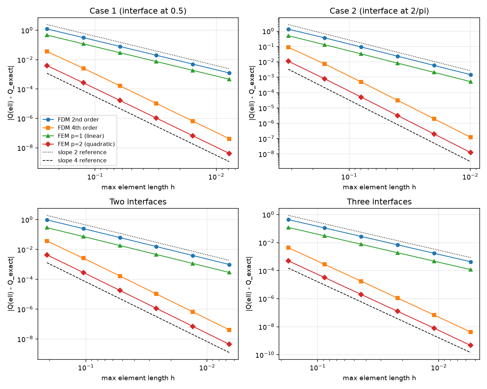
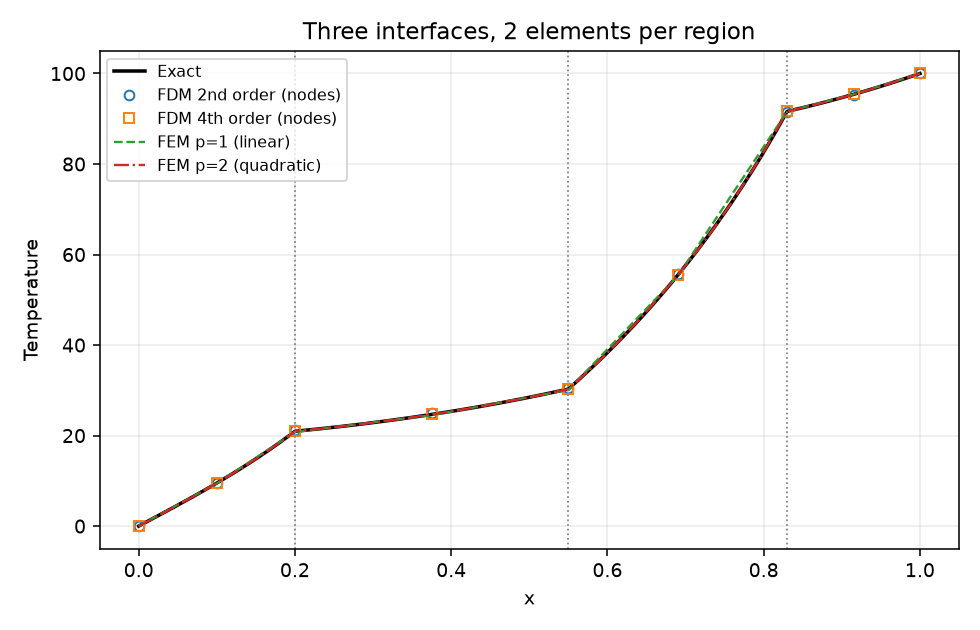

# Heat Transfer Numerical Solvers

Finite difference and finite element solvers for 1D steady heat conduction in a bar with
convective (Newton) heat loss and material interfaces. Each method assembles a global system,
applies Dirichlet boundary conditions with a penalty method, and is checked for convergence
with Richardson extrapolation and an exact solution.

This code started as my AERO 430 (Numerical Simulation of Thermal Systems) Assignments 4 and 5
at Texas A&M, Spring 2026. I cleaned it up so both methods share one mesh, assembly and
post-processing module.

## Problem setup

Inside each material region the temperature satisfies

```
-d/dx( kappa A dT/dx ) + h P T = 0,     T(0) = 0,   T(ell) = 100
```

- Bar length `ell = 1`, radius `r = 0.1`, so `A = pi r^2` and `P = 2 pi r`
- Convection coefficient `h = 1` in every region, ambient temperature 0
- Conductivity `kappa` is constant inside a region and jumps at each interface

Benchmark cases:

| Case | Interface locations | kappa in each region |
|---|---|---|
| Case 1 | 0.5 | 1, 4 |
| Case 2 | 2/pi | 1, 4 |
| Two interfaces | 0.30, 0.72 | 1, 4, 0.5 |
| Three interfaces | 0.20, 0.55, 0.83 | 1, 8, 2, 16 |

**Exact solution.** In each region `T = C1 cosh(alpha x) + C2 sinh(alpha x)` with
`alpha^2 = h P / (kappa A)`. Temperature and heat rate `kappa A dT/dx` are continuous at the
interfaces, so I chain a 2x2 transfer matrix per region and solve for the unknown heat rate at
`x = 0`. This gives the exact temperature and the exact hot-end heat loss for any number of
interfaces.

**Verification quantity.** The heat loss at the hot end, `Q(ell) = -kappa A dT/dx` at `x = ell`
(the same definition as in the assignments). It is negative here because heat flows into the
bar at `x = ell`. The numerical `Q(ell)` comes from the last element's equation at node N, so
it never differentiates the numerical solution.

## Methods

| Method | File | Element |
|---|---|---|
| FDM 2nd order | `element_fdm.py` | 2-node element, Taylor expansion of end heat rates to O(dx^2) |
| FDM 4th order | `element_fdm.py` | 2-node element, Taylor expansion to O(dx^4) |
| FEM p=1 | `fem.py` | linear (first-order) shape functions, weak form |
| FEM p=2 | `fem.py` | quadratic (second-order) shape functions, weak form |

Shared steps (`assembly.py`):

1. Mesh: `n` equal elements per material region, so every interface is a node.
2. Assemble the global stiffness matrix from the element matrices.
3. Penalty method for `T(0)` and `T(ell)`: add `1e12 * max(diag(K))` to the two end diagonal
   entries and the matching terms to the right-hand side.
4. Solve with `numpy.linalg.solve` and extract `Q(ell)`.

Convergence (`convergence.py`):

- Order from the exact error: `p = log2(e_h / e_{h/2})`
- Richardson order from three meshes (no exact solution needed):
  `p = log2(|Q_h - Q_{h/2}| / |Q_{h/2} - Q_{h/4}|)`
- Richardson extrapolated value: `Q_R = Q_{h/4} + (Q_{h/4} - Q_{h/2}) / (2^p - 1)`

## Results

All numbers below are produced by `run_study.py` and saved in `results/`. Mesh sizes are
`n = 2, 4, 8, 16, 32, 64` elements per region. `h max` is the longest element.

### Case 2 (interface at 2/pi), exact Q(ell) = -24.6672281743

Error in `Q(ell)` against the exact solution, and the observed order between each mesh and the
previous one:

| n per region | h max | FDM 2nd error | order | FDM 4th error | order | FEM p=1 error | order | FEM p=2 error | order |
|---|---|---|---|---|---|---|---|---|---|
| 2 | 0.31831 | 1.348e+00 | - | 8.978e-02 | - | 5.055e-01 | - | 1.109e-02 | - |
| 4 | 0.15915 | 3.633e-01 | 1.891 | 7.275e-03 | 3.625 | 1.306e-01 | 1.953 | 7.852e-04 | 3.821 |
| 8 | 0.07958 | 9.289e-02 | 1.968 | 4.894e-04 | 3.894 | 3.294e-02 | 1.987 | 5.078e-05 | 3.951 |
| 16 | 0.03979 | 2.336e-02 | 1.992 | 3.117e-05 | 3.973 | 8.253e-03 | 1.997 | 3.201e-06 | 3.987 |
| 32 | 0.01989 | 5.849e-03 | 1.998 | 1.958e-06 | 3.993 | 2.064e-03 | 1.999 | 2.005e-07 | 3.997 |
| 64 | 0.00995 | 1.463e-03 | 1.999 | 1.225e-07 | 3.999 | 5.162e-04 | 2.000 | 1.252e-08 | 4.001 |

Richardson extrapolation on the three finest meshes (n = 16, 32, 64), without the exact solution:

| Method | Q(ell) at n = 64 | Richardson order | Extrapolated Q(ell) |
|---|---|---|---|
| FDM 2nd order | -24.6686908764 | 1.997 | -24.6672252676 |
| FDM 4th order | -24.6672282968 | 3.993 | -24.6672281738 |
| FEM p=1 | -24.6677443615 | 1.999 | -24.6672277865 |
| FEM p=2 | -24.6672281869 | 3.996 | -24.6672281743 |

The full Richardson table for every mesh is in `results/convergence_tables.md`.

### Observed order on the finest mesh pair, all cases

Each cell is (order from exact error) / (Richardson order), using n = 32 and 64
(and n = 16 for the Richardson value).

| Case | FDM 2nd | FDM 4th | FEM p=1 | FEM p=2 |
|---|---|---|---|---|
| Expected | 2 | 4 | 2 | 4 |
| Case 1 (interface at 0.5) | 2.000 / 1.999 | 3.999 / 3.997 | 2.000 / 2.000 | 3.988 / 3.999 |
| Case 2 (interface at 2/pi) | 1.999 / 1.997 | 3.999 / 3.993 | 2.000 / 1.999 | 4.001 / 3.996 |
| Two interfaces | 2.000 / 1.999 | 3.999 / 3.997 | 2.000 / 2.000 | 4.001 / 3.999 |
| Three interfaces | 2.000 / 2.000 | 4.032 / 3.996 | 2.000 / 2.000 | 4.083 / 3.988 |





### Notes on the results

- The expected order for the FDM elements comes from where the Taylor series is truncated. For
  the FEM, linear and quadratic elements in 1D give nodal values and element-equation heat rates
  that converge at order 2p, so 2 for p=1 and 4 for p=2. The observed orders match on all four
  cases.
- On coarse meshes (n = 2 to 8) the orders are below the expected value, for example 3.625 for
  FDM 4th order on Case 2. The error is not yet in the asymptotic range there.
- For the three-interface case the 4th-order methods show 4.032 and 4.083 on the finest pair,
  slightly above 4. Their errors there are about 4e-9 and 5e-10. I checked this by changing the
  penalty factor from 1e10 to 1e14, which did not change the n = 64 error, and by refining to
  n = 128 (not part of the saved study). At n = 128 the FDM 4th-order error only dropped to
  about 7e-10 (order about 2.6) and the FEM p=2 error went up to about 4e-9. So the last
  refinement is starting to reach round-off error, and the order on that pair is less
  reliable. Case 1 FEM p=2 (3.988) has its n = 64 error in the same range, about 4e-9.
- The interfaces do not reduce the order because every interface sits on a node.

## How to run

From a PowerShell terminal in the project folder (tested with Python 3.14, numpy 2.5.4,
matplotlib 3.11.2):

```powershell
python -m venv .venv
.\.venv\Scripts\python.exe -m pip install -r requirements.txt
.\.venv\Scripts\python.exe run_study.py
.\.venv\Scripts\python.exe -m unittest discover tests -v
```

`run_study.py` prints the tables and writes to `results/`:

- `convergence_all_cases.csv`: every case, method and mesh
- `convergence_tables.md`: the tables above
- `heat_loss_convergence.png`: log-log error plot for all cases
- `temperature_three_interfaces.png`: temperature profiles on a coarse mesh

## Project layout

```
bar_problem.py     physical constants, benchmark cases, exact solution
assembly.py        mesh, global assembly, penalty boundary conditions, heat loss
element_fdm.py     2nd- and 4th-order element FDM matrices
fem.py             p=1 and p=2 FEM element matrices, FEM interpolation
convergence.py     mesh refinement study and Richardson extrapolation
run_study.py       runs everything and saves results
tests/             unit tests
```
